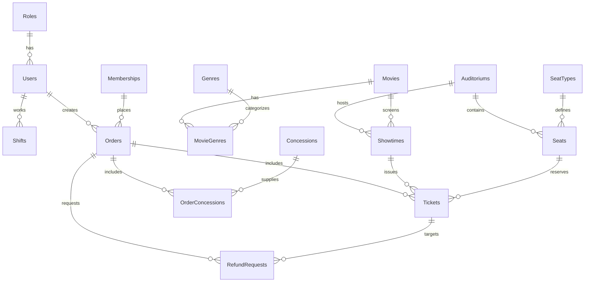

# STORYLINE CINEMA - QUY TẮC THIẾT KẾ & ĐẶC TẢ CƠ SỞ DỮ LIỆU
**Hệ thống Quản lý & Bán vé Rạp Chiếu Phim STORYLINE**  
*Tài liệu chuẩn hóa Database Architecture, Naming Conventions, Data Types & Business Rules*  
*Phiên bản: 1.0 - Chuẩn SQL Server 2019/2022 & EF Core 10*

---

## MỤC LỤC
1. [Nguyên Tắc Thiết Kế Tổng Thể](#1-nguyên-tắc-thiết-kế-tổng-thể)
2. [Quy Tắc Đặt Tên (Naming Conventions)](#2-quy-tắc-đặt-tên-naming-conventions)
3. [Quy Chuẩn Kiểu Dữ Liệu (Data Types Standard)](#3-quy-chuẩn-kiểu-dữ-liệu-data-types-standard)
4. [Quy Chuẩn Audit Trail & Xóa Mềm (Soft Delete)](#4-quy-chuẩn-audit-trail--xóa-mềm-soft-delete)
5. [Cấu Trúc 18 Bảng Chuẩn Hóa (Database Schema)](#5-cấu-trúc-18-bảng-chuẩn-hóa-database-schema)
6. [Quy Tắc Nghiệp Vụ Trọng Yếu (Critical Business Rules)](#6-quy-tắc-nghiệp-vụ-trọng-yếu-critical-business-rules)
7. [Chính Sách Lập Chỉ Mục (Indexing Strategy)](#7-chính-sách-lập-chỉ-mục-indexing-strategy)
8. [Hướng Dẫn Cài Đặt & Triển Khai (Deployment Guide)](#8-hướng-dẫn-cài-đặt--triển-khai-deployment-guide)

---

## 1. NGUYÊN TẮC THIẾT KẾ TỔNG THỂ

1. **Chuẩn Hóa Dữ Liệu (Third Normal Form - 3NF):**  
   - Mọi bảng đều đạt chuẩn hóa 3NF để loại trừ triệt để tình trạng dư thừa dữ liệu (redundancy) và đảm bảo tính toàn vẹn khi Thêm/Sửa/Xóa (Anomalies Prevention).
   - Ngoại lệ có kiểm soát: Lưu giá bán lịch sử (`UnitPrice`, `TicketPrice`) tại thời điểm tạo giao dịch để báo cáo tài chính không bị biến động khi danh mục thay đổi đơn giá sau này.

2. **Toàn Vẹn Dữ Liệu (Referential Integrity):**  
   - Mọi quan hệ giữa các thực thể đều được ràng buộc bằng Khóa Ngoại (Foreign Key) tường minh.
   - Không sử dụng `CASCADE DELETE` nguy hiểm trên các bảng giao dịch tài chính (`Orders`, `Tickets`, `Shifts`). Sử dụng cơ chế Xóa Mềm (`IsDeleted = 1`) hoặc `ON DELETE NO ACTION / RESTRICT`.

3. **Hiệu Năng & Khả Năng Mở Rộng (Performance & Scalability):**  
   - Sử dụng Filtered Indexes (Chỉ mục có điều kiện) cho việc chống mua trùng vé (`Double-booking`) và tra cứu dữ liệu chưa xóa (`WHERE IsDeleted = 0`).
   - Thiết kế phù hợp cho cả ứng dụng Windows Forms (POS quầy vé) và ASP.NET Core Web (Khách đặt vé online) cùng chia sẻ một CSDL duy nhất.

---

## 2. QUY TẮC ĐẶT TÊN (NAMING CONVENTIONS)

Tuân thủ nghiêm ngặt chuẩn quốc tế SQL Server và tương thích hoàn hảo với Entity Framework Core:

| Đối Tượng | Quy Tắc Đặt Tên | Quy Cách | Ví Dụ Minh Họa |
| :--- | :--- | :--- | :--- |
| **Bảng (Tables)** | PascalCase, Danh từ số nhiều | `{EntityName}s` | `Movies`, `Showtimes`, `Tickets`, `Auditoriums`, `Concessions` |
| **Bảng liên kết N-N** | Ghép tên 2 thực thể số nhiều | `{Entity1}{Entity2}` | `MovieGenres` (kết nối `Movies` và `Genres`) |
| **Cột (Columns)** | PascalCase, Tên đơn nghĩa | `{AttributeName}` | `Title`, `DurationMinutes`, `BasePrice`, `CreatedAt` |
| **Khóa chính (PK)** | PascalCase, Tên thực thể + Id | `{EntityName}Id` | `MovieId`, `ShowtimeId`, `TicketId`, `OrderId` |
| **Khóa ngoại (FK)** | Giống hệt tên PK của bảng cha | `{ParentEntity}Id` | `AuditoriumId` trong bảng `Showtimes` tham chiếu tới `Auditoriums(AuditoriumId)` |
| **Ràng buộc PK** | Tiền tố `PK_` + Tên bảng | `PK_{Table}` | `PK_Movies`, `PK_Showtimes`, `PK_Orders` |
| **Ràng buộc FK** | `FK_{BảngCon}_{BảngCha}_{Cột}` | `FK_{Child}_{Parent}_{Col}` | `FK_Showtimes_Movies_MovieId`, `FK_Tickets_Showtimes_ShowtimeId` |
| **Ràng buộc Duy nhất** | Tiền tố `UQ_` + Tên bảng + Cột | `UQ_{Table}_{Col}` | `UQ_Users_Username`, `UQ_Users_Email`, `UQ_Memberships_PhoneNumber` |
| **Ràng buộc Kiểm tra** | Tiền tố `CK_` + Tên bảng + Nội dung | `CK_{Table}_{Rule}` | `CK_Movies_DurationMinutes_Positive`, `CK_Orders_FinalAmount_NonNegative` |
| **Giá trị Mặc định** | Tiền tố `DF_` + Tên bảng + Cột | `DF_{Table}_{Col}` | `DF_Movies_CreatedAt`, `DF_Tickets_Status`, `DF_Users_IsActive` |
| **Chỉ mục thường** | Tiền tố `IX_` + Tên bảng + Cột | `IX_{Table}_{Col}` | `IX_Showtimes_StartTime`, `IX_Orders_OrderDate`, `IX_Movies_Status` |

---

## 3. QUY CHUẨN KIỂU DỮ LIỆU (DATA TYPES STANDARD)

1. **Chuỗi Ký Tự Tiếng Việt (Unicode):**
   - Bắt buộc dùng `NVARCHAR(n)` cho mọi trường chứa ngôn ngữ tiếng Việt có dấu: Họ tên, Tên phim, Địa chỉ, Mô tả, Thể loại, Ghi chú.
   - Không dùng `VARCHAR` cho dữ liệu hiển thị người dùng; chỉ dùng `VARCHAR(n)` cho mã định danh ASCII, Barcode, Phone, RoleName (ví dụ: `VARCHAR(50)`).
   - Không lạm dụng `NVARCHAR(MAX)` ngoại trừ các trường văn bản nội dung lớn như tóm tắt phim (`Synopsis/Description`) hoặc `AuditLogs(OldValues/NewValues)`.

2. **Tiền Tệ & Giá Cả (Financial & Currency):**
   - **Bắt buộc dùng `DECIMAL(18,2)`** cho toàn bộ các trường liên quan đến tiền bạc (`BasePrice`, `TicketPrice`, `UnitPrice`, `SubTotal`, `DiscountAmount`, `FinalAmount`, `RefundAmount`).
   - Tuyệt đối cấm sử dụng `FLOAT` hoặc `REAL` vì sai số dấu phẩy động (Floating point precision errors) gây chênh lệch tiền kế toán.

3. **Thời Gian & Ngày Tháng (Date & Time):**
   - Mốc thời gian hệ thống (Audit): `DATETIME2(0)` hoặc `DATETIME2(7)` (tiết kiệm dung lượng và chính xác cao hơn `DATETIME` cũ).
   - Ngày sinh, ngày phát hành, ngày hết hạn: `DATE`.
   - Giờ bắt đầu, giờ kết thúc (nếu tách rời): `TIME(0)`.
   - Mọi giá trị mặc định thời gian sử dụng hàm `SYSUTCDATETIME()` hoặc `GETDATE()`.

4. **Trạng Thái & Logic (Flags & Enums):**
   - Cờ logic nhị phân: `BIT` (`1` = True/Active, `0` = False/Inactive).
   - Trạng thái quy trình: Dùng `NVARCHAR(30)` hoặc `VARCHAR(30)` đi kèm ràng buộc `CHECK (Status IN ('...', '...'))` để vừa dễ đọc trực quan khi query vừa đảm bảo toàn vẹn.

---

## 4. QUY CHUẨN AUDIT TRAIL & XÓA MỀM (SOFT DELETE)

Mọi bảng nghiệp vụ cốt lõi (Core Tables: `Movies`, `Users`, `Auditoriums`, `Showtimes`, `Concessions`) đều bắt buộc có 5 cột tiêu chuẩn:

```sql
CreatedAt   DATETIME2(0) NOT NULL CONSTRAINT DF_{Table}_CreatedAt DEFAULT GETDATE(),
CreatedBy   NVARCHAR(50) NULL,
UpdatedAt   DATETIME2(0) NULL,
UpdatedBy   NVARCHAR(50) NULL,
IsDeleted   BIT NOT NULL CONSTRAINT DF_{Table}_IsDeleted DEFAULT 0
```

- **Quy tắc Xóa mềm (Soft Delete Rule):**
  - Khi người dùng xóa phim, phòng chiếu, bắp nước hoặc nhân viên, hệ thống KHÔNG chạy lệnh `DELETE FROM ...`.
  - Thay vào đó chạy `UPDATE {Table} SET IsDeleted = 1, UpdatedAt = GETDATE(), UpdatedBy = @CurrentUser WHERE {Id} = @Id`.
  - Toàn bộ câu truy vấn nghiệp vụ hàng ngày (Listing, Dropdown, Search) luôn lọc: `WHERE IsDeleted = 0`.
  - Bảng con có chứa dữ liệu lịch sử (ví dụ `Tickets`, `Orders` đã phát sinh) vẫn hiển thị đầy đủ thông tin cha nhờ khóa ngoại không bị xóa vật lý.

---

## 5. CẤU TRÚC 18 BẢNG CHUẨN HÓA (DATABASE SCHEMA)

Hệ thống bao gồm 18 bảng dữ liệu phân chia thành 6 phân hệ chức năng:



### Danh Sách 18 Bảng:
1. **`Roles`**: Danh mục vai trò phân quyền (`Admin`, `Manager`, `Staff`).
2. **`Users`**: Tài khoản nhân sự đăng nhập hệ thống nội bộ WinForms & Web Management.
3. **`Memberships`**: Khách hàng thành viên tích điểm (Tiers: `Standard`, `Silver`, `Gold`, `Platinum`).
4. **`Genres`**: Danh mục thể loại phim (Hành động, Hoạt hình, Kinh dị, Tình cảm...).
5. **`Movies`**: Danh mục phim chiếu rạp, độ tuổi, thời lượng, trạng thái chiếu.
6. **`MovieGenres`**: Bảng quan hệ N-N giữa Phim và Thể loại.
7. **`Auditoriums`**: Danh sách phòng chiếu (Cinema 01, IMAX Laser, 3D...).
8. **`SeatTypes`**: Loại ghế & phụ thu (Standard, VIP, Sweetbox/Couple, Accessible).
9. **`Seats`**: Sơ đồ ghế thực tế theo từng phòng (Mã ghế A01, A02, B05...).
10. **`Showtimes`**: Lịch chiếu phim theo phòng, giờ bắt đầu, giờ kết thúc và giá gốc.
11. **`Concessions`**: Danh mục bắp nước, combo ăn uống, tồn kho và giá bán.
12. **`Orders`**: Hóa đơn giao dịch tổng (Vé + Bắp nước, thanh toán, điểm thưởng).
13. **`Tickets`**: Chi tiết vé xem phim từng ghế, mã vạch (Barcode), trạng thái vé.
14. **`OrderConcessions`**: Chi tiết bắp nước trong hóa đơn.
15. **`Shifts`**: Quản lý ca làm việc của nhân viên thu ngân và kết ca đối soát tiền.
16. **`RefundRequests`**: Quản lý yêu cầu trả vé, hoàn tiền cho khách.
17. **`SystemConfigs`**: Cấu hình tham số hệ thống động (Phút giữ ghế, điểm thưởng...).
18. **`AuditLogs`**: Nhật ký truy vết vết tác vụ hệ thống phục vụ an ninh bảo mật.

---

## 6. DANH MỤC RÀNG BUỘC TOÀN VẸN & TRIGGERS (INTEGRITY & VALIDATION MATRIX)

Hệ thống triển khai mô hình **Bảo vệ Đa Tầng (Multi-Tier Defense-in-Depth)**:
1. **Tầng Cơ sở Dữ liệu (Database Engine):** Ràng buộc vật lý (Check Constraints, Foreign Keys, Filtered Indexes, Triggers) — *Không thể bị vượt qua dù gọi từ WinForms, Web, API hay truy vấn SQL thủ công*.
2. **Tầng Entity Framework Core (ORM):** Fluent API + Data Annotations kiểm soát kiểu dữ liệu và định dạng.
3. **Tầng Giao diện Ứng dụng (UI/UX):** Validate thời gian thực (Realtime Validation) với phản hồi tức thì cho người dùng.

### 6.1. Bảng Tổng Hợp Ràng Buộc Kiểm Tra (Check Constraints)

| Bảng (Table) | Tên Ràng Buộc (Constraint) | Biểu Thức Kiểm Tra (Rule) | Ý Nghĩa Nghiệp Vụ |
| :--- | :--- | :--- | :--- |
| **`Users`** | `CK_Users_Username_Format` | `LEN(Username) >= 3 AND Username NOT LIKE '%[^a-zA-Z0-9_]%'` | Tài khoản tối thiểu 3 ký tự, không chứa ký tự đặc biệt |
| | `CK_Users_Email` | `Email IS NULL OR (Email LIKE '%_@__%.__%')` | Định dạng chuẩn Email |
| | `CK_Users_PhoneNumber` | `PhoneNumber IS NULL OR (LEN(PhoneNumber) BETWEEN 10 AND 11 AND PhoneNumber NOT LIKE '%[^0-9]%')` | Số điện thoại 10-11 chữ số |
| **`Memberships`** | `CK_Memberships_Tier` | `TierLevel IN ('Standard', 'Silver', 'Gold', 'Platinum')` | 4 hạng thẻ hội viên chuẩn |
| | `CK_Memberships_Points` | `Points >= 0` | Điểm tích lũy không được âm |
| | `CK_Memberships_TotalSpent` | `TotalSpent >= 0` | Tổng tiền chi tiêu không được âm |
| **`Movies`** | `CK_Movies_DurationMinutes` | `DurationMinutes > 0` | Thời lượng phim phải lớn hơn 0 phút |
| | `CK_Movies_Dates_Valid` | `EndDate IS NULL OR EndDate >= ReleaseDate` | Ngày kết thúc phải sau ngày khởi chiếu |
| | `CK_Movies_AgeRating` | `AgeRating IN ('P', 'K', 'T13', 'T16', 'T18', 'C')` | Chuẩn phân loại độ tuổi rạp chiếu Việt Nam |
| | `CK_Movies_Status` | `Status IN ('ComingSoon', 'NowShowing', 'EndOfShowing')` | Trạng thái phát hành phim |
| **`Auditoriums`**| `CK_Auditoriums_Rows_Cols` | `TotalRows > 0 AND TotalColumns > 0` | Số hàng và cột ghế phải dương |
| | `CK_Auditoriums_ScreenType` | `ScreenType IN ('2D Standard', '3D Digital', 'IMAX Laser', '4DX', 'ScreenX')` | Danh mục công nghệ phòng chiếu |
| | `CK_Auditoriums_Status` | `Status IN ('Active', 'Maintenance', 'Inactive')` | Trạng thái sẵn sàng của phòng |
| **`SeatTypes`** | `CK_SeatTypes_Surcharge` | `SurchargeAmount >= 0` | Phụ thu loại ghế không âm |
| | `CK_SeatTypes_TypeName` | `TypeName IN ('Standard', 'VIP', 'Sweetbox', 'Accessible')` | 4 nhóm loại ghế |
| **`Showtimes`** | `CK_Showtimes_Times_Valid`| `EndTime > StartTime` | Giờ kết thúc phải sau giờ bắt đầu |
| | `CK_Showtimes_BasePrice` | `BasePrice > 0` | Giá vé gốc của suất chiếu phải > 0 |
| | `CK_Showtimes_Status` | `Status IN ('Scheduled', 'Showing', 'Finished', 'Cancelled')` | Vòng đời của một suất chiếu |
| **`Concessions`** | `CK_Concessions_UnitPrice` | `UnitPrice >= 0` | Giá bán lẻ không âm |
| | `CK_Concessions_Stock` | `StockQuantity >= 0` | Số lượng tồn kho không được âm |
| | `CK_Concessions_Category`| `Category IN ('Popcorn', 'Beverage', 'Combo', 'Snack')` | Phân loại hàng ăn uống |
| **`Orders`** | `CK_Orders_Amounts_Valid` | `SubTotal >= 0 AND DiscountAmount >= 0 AND FinalAmount >= 0` | Các mốc tiền không được âm |
| | `CK_Orders_FinalAmount_Math` | `FinalAmount <= SubTotal` | Số tiền sau giảm không vượt quá tổng tạm tính |
| | `CK_Orders_PaymentMethod` | `PaymentMethod IN ('CASH', 'VNPay', 'MoMo', 'VietQR', 'Card')` | Phương thức thanh toán được chấp nhận |
| | `CK_Orders_PaymentStatus` | `PaymentStatus IN ('PENDING', 'PAID', 'REFUNDED', 'FAILED')` | Trạng thái giao dịch tiền |
| **`Tickets`** | `CK_Tickets_Price_Positive`| `TicketPrice >= 0` | Giá vé bán thực tế không âm |
| | `CK_Tickets_Status` | `Status IN ('ISSUED', 'USED', 'REFUNDED', 'CANCELLED')` | Trạng thái vé theo quy trình |
| **`Shifts`** | `CK_Shifts_Status` | `Status IN ('OPEN', 'CLOSED')` | Trạng thái ca làm việc |
| | `CK_Shifts_Times` | `EndTime IS NULL OR EndTime >= StartTime` | Giờ kết ca phải sau giờ mở ca |
| | `CK_Shifts_Cash` | `InitialCash >= 0 AND TotalSales >= 0` | Tiền đầu ca & doanh số không âm |
| **`RefundRequests`**| `CK_RefundRequests_Amount`| `RefundAmount > 0` | Số tiền hoàn trả phải lớn hơn 0 |

---

### 6.2. Các Triggers Tự Động Hóa Nghiệp Vụ Cốt Lõi

1. **`trg_EnforceShowtimeOverlap` (Bảo vệ Lịch chiếu):**  
   - Bắt sự kiện `INSERT / UPDATE` trên bảng `Showtimes`.
   - Tự động cộng thêm 15 phút dọn dẹp vệ sinh phòng chiếu (`@CleanBufferMinutes = 15`).
   - Ngăn chặn hoàn toàn việc nhân viên xếp 2 phim đè lên nhau tại cùng 1 phòng chiếu.
   - Bắn lỗi hệ thống (Severity 16) và Rollback ngay lập tức nếu vi phạm.

2. **`trg_ValidateTicketSeatAuditorium` (Bảo vệ Toàn vẹn Vé & Ghế):**  
   - Bắt sự kiện `INSERT / UPDATE` trên bảng `Tickets`.
   - Xác minh: `Seats.AuditoriumId == Showtimes.AuditoriumId`.
   - Chặn đứng lỗi "mua nhầm ghế phòng 1 cho suất chiếu ở phòng 3".
   - Kiểm tra `Seats.IsActive = 1` (chặn mua ghế đang hỏng hoặc bị khóa bảo trì).

3. **`trg_AutoUpdateStockOnConcessionOrder` (Quản lý Kho & Bắp nước):**  
   - Bắt sự kiện `INSERT` trên bảng `OrderConcessions`.
   - Kiểm tra `StockQuantity >= Quantity`. Nếu không đủ hàng, ném lỗi và từ chối xuất bán.
   - Tự động trừ số lượng tồn kho `StockQuantity = StockQuantity - Quantity` mà không cần code ứng dụng phải viết câu `UPDATE` thủ công.

4. **`trg_AutoUpdateMembershipPointsOnPaidOrder` (Tích điểm & Nâng hạng Thẻ):**  
   - Bắt sự kiện cập nhật đơn hàng thành `PaymentStatus = 'PAID'`.
   - Tự động cộng dồn `TotalSpent`, tính điểm `Points = Points + PointsEarned - PointsRedeemed`.
   - Tự động thăng hạng khách hàng:  
     - $\ge 5,000,000$ VND: Hạng **Platinum**  
     - $\ge 3,000,000$ VND: Hạng **Gold**  
     - $\ge 1,000,000$ VND: Hạng **Silver**  
     - Dưới $1,000,000$ VND: Hạng **Standard**

---

### 6.3. Cơ Chế Chống Bán Trùng Ghế (Double-Booking Engine)
- Thiết lập **Unique Filtered Index** tại CSDL SQL Server:
  ```sql
  CREATE UNIQUE NONCLUSTERED INDEX UQ_Tickets_Showtime_Seat_Active
  ON dbo.Tickets (ShowtimeId, SeatId)
  WHERE Status <> 'REFUNDED' AND Status <> 'CANCELLED';
  ```
- **Khẳng định:** Cùng 1 suất chiếu và 1 ghế, chỉ tồn tại duy nhất 1 vé có hiệu lực. Cho dù 100 khách cùng bấm mua 1 chỗ tại cùng 1 mili-giây, cơ chế khóa vật lý (Row-level Lock) của SQL Server đảm bảo chỉ có 1 giao dịch thành công. Khi vé bị hoàn trả (`Status = 'REFUNDED'`), ghế tự động được nhả để bán tiếp.

---

## 7. CHÍNH SÁCH LẬP CHỈ MỤC (INDEXING STRATEGY)

Để đảm bảo hiệu năng tức thì (đáp ứng < 50ms cho các thao tác POS quầy vé và tra cứu online):

1. **Clustered Indexes (Mặc định):**
   - Đặt trên Khóa chính `IDENTITY(1,1)` của mỗi bảng.

2. **Non-Clustered Indexes trên Khóa Ngoại (Foreign Keys):**
   - Mọi cột khóa ngoại đều được đánh chỉ mục để tối ưu hóa phép `JOIN` giữa các bảng:
     - `IX_Showtimes_MovieId`, `IX_Showtimes_AuditoriumId`
     - `IX_Seats_AuditoriumId`, `IX_Seats_SeatTypeId`
     - `IX_Tickets_OrderId`, `IX_Tickets_ShowtimeId`, `IX_Tickets_SeatId`
     - `IX_OrderConcessions_OrderId`, `IX_OrderConcessions_ConcessionId`

3. **Composite & Covering Indexes:**
   - Tra cứu lịch chiếu theo ngày & phim:  
     `IX_Showtimes_Movie_StartTime (MovieId, StartTime) INCLUDE (AuditoriumId, BasePrice, Status)`
   - Tra cứu vé theo mã vạch quét máy Scanner:  
     `UQ_Tickets_Barcode (Barcode)`
   - Tra cứu thành viên theo số điện thoại:  
     `UQ_Memberships_PhoneNumber (PhoneNumber)`

---

## 8. HƯỚNG DẪN CÀI ĐẶT & TRIỂN KHAI (DEPLOYMENT GUIDE)

### Bước 1: Mở SQL Server Management Studio (SSMS) hoặc Azure Data Studio
Kết nối tới SQL Server cục bộ:
- Server name: `.` hoặc `localhost` hoặc `(localdb)\mssqllocaldb`
- Authentication: `Windows Authentication` hoặc `SQL Server Authentication (sa)`

### Bước 2: Thực thi Script Khởi Tạo
- Mở file: `CinemaManagement/database/Cinema.Setup.sql`
- Nhấn **Execute (F5)**. Toàn bộ CSDL `CinemaManagementDb`, 18 bảng, ràng buộc, chỉ mục và bộ dữ liệu mẫu (Seed Data) chuẩn tiếng Việt sẽ được tạo lập tự động.

### Bước 3: Cấu hình Connection String
Trong file `appsettings.json` (ASP.NET Core) hoặc `App.config` (WinForms):
```json
"ConnectionStrings": {
  "CinemaDbConnection": "Server=localhost;Database=CinemaManagementDb;Trusted_Connection=True;TrustServerCertificate=True;"
}
```

---
*Tài liệu được biên soạn đồng bộ với mã nguồn C# Solution `CinemaManagement.slnx`.*
